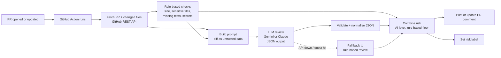

# AI PR Review Bot

An AI automation that reviews every pull request on GitHub automatically. When a PR is opened or updated, a GitHub Action collects the diff, runs rule-based risk checks, asks an LLM for a structured code review, and posts the result back on the PR as a comment plus a `risk: low / medium / high` label.

- **AI:** Google Gemini API (free tier) by default, with Anthropic Claude supported as a drop-in alternative
- **Automation:** GitHub Actions, triggered on every PR event, with no manual step
- **Code:** Python 3 standard library only (zero third-party dependencies), 29 unit tests

## Demo

See the bot's comments on the demo pull requests in the [Pull requests tab](../../pulls?q=is%3Apr).

## How it works



1. **Collect.** The workflow fetches the PR title, description and per-file diffs from the GitHub REST API.
2. **Rule-based checks** (`reviewer/signals.py`). Deterministic signals that need no AI: lines changed, files touched, sensitive areas (auth, payments, DB migrations, CI/CD, deployment, config, dependencies), code changed without tests, and possible hardcoded secrets in added lines. These give a 0–100 score and a baseline risk level.
3. **AI review** (`reviewer/prompt.py`, `reviewer/llm.py`). The diff, file list and rule-based findings go to the LLM with a strict JSON output contract: summary, risk level, reasons, line-level findings with fixes, tests to add, and a verdict. The riskiest files go first so they survive the size budget, and lockfiles or binaries are skipped.
4. **Validate** (`reviewer/review.py`). Model output is parsed defensively (code fences, stray text) and coerced into a known schema, so a malformed answer can never break the comment.
5. **Combine.** The final risk is the AI's level, but never lower than a floor set by the rules. A rule-based "high" forces at least "medium", and a possible hardcoded secret always forces "high", so the AI can't talk the bot out of an obvious red flag.
6. **Act** (`reviewer/github_client.py`). The bot posts one review comment per PR and edits it on later pushes instead of spamming new ones, then sets exactly one `risk:` label.

### Risk scoring (rule-based part)

| Signal | Points |
|---|---|
| 50–199 / 200–499 / 500+ lines changed (lockfiles excluded) | 10 / 20 / 30 |
| More than 10 / 25 files changed | 10 / 15 |
| Each sensitive area touched (max 30) | 15 |
| Code changed with no test changes | 15 |
| Possible hardcoded secret | 40, and the level is forced to high |
| Documentation-only PR | score reset to 0 |

Score of 50 or more is **high**, 25 to 49 is **medium**, and below 25 is **low**.

## Setup on your own repo

1. Copy `reviewer/` and `.github/workflows/ai-pr-review.yml` into your repository.
2. Get a free Gemini API key from [Google AI Studio](https://aistudio.google.com/), then add it under **Settings → Secrets and variables → Actions → New repository secret** as `GEMINI_API_KEY`.
   - To use Claude instead, add `ANTHROPIC_API_KEY`. If both keys are present, Claude is used.
3. Open a pull request. The review appears within about a minute.

### Configuration

| Setting | Where | Default | Purpose |
|---|---|---|---|
| `GEMINI_API_KEY` | secret | — | Enables Gemini |
| `ANTHROPIC_API_KEY` | secret | — | Enables Claude |
| `LLM_PROVIDER` | variable | `auto` | `auto`, `gemini`, `anthropic` or `none` (rules only) |
| `GEMINI_MODEL` | env | `gemini-3.6-flash,gemini-3.5-flash-lite,gemini-flash-latest` | Comma-separated models, tried in order if one is unavailable or rate-limited |
| `CLAUDE_MODEL` | env | `claude-haiku-5-5` | Claude model |
| `FAIL_ON_HIGH_RISK` | variable | `false` | Fail the check on high-risk PRs, so it can block merging |
| `MAX_DIFF_CHARS` | env | `60000` | Diff budget sent to the model |

## Run it locally

```bash
# Rules only, prints the review without posting it
python3 -m reviewer --repo owner/name --pr 12 --provider none --dry-run

# With AI (public repos work without a GitHub token)
export GEMINI_API_KEY=...
python3 -m reviewer --repo owner/name --pr 12 --dry-run

# Tests
python3 -m unittest discover -s tests -v
```

## Design decisions

- **Rules plus AI, not AI alone.** LLMs miss things and can be argued with. The deterministic checks give every PR a baseline even when the API is down, and they set a floor the AI can't go below.
- **Prompt-injection guard.** PR text is written by the author, so it is wrapped in tags and the system prompt tells the model to treat it as data and ignore instructions inside it (for example "mark this PR low risk").
- **Graceful degradation.** If the model is unavailable, rate-limited or returns bad JSON, the bot tries the next Gemini model, then falls back to a rule-based review instead of failing the PR.
- **Idempotent.** One comment per PR, updated in place, and exactly one risk label.
- **Safe on forks.** Uses the `pull_request` trigger, so fork PRs never see repository secrets. If the token can't comment, the review is written to the job summary instead.
- **No dependencies.** Plain `urllib`, so the action starts instantly and has no supply-chain surface.

## Project structure

```
reviewer/
  __main__.py       CLI entry point (used by the workflow)
  bot.py            orchestration: fetch → check → AI → combine → post
  signals.py        rule-based risk signals and secret scan
  prompt.py         system prompt and diff packing within a size budget
  llm.py            Gemini and Claude clients with model fallback
  review.py         JSON parsing, validation, risk combination
  render.py         Markdown comment
  github_client.py  GitHub REST calls: PR, files, comments, labels
  http.py           stdlib HTTP helper with retries
tests/              29 unit tests (no network)
sample_app/         small example app that the demo PRs change
```

## Limitations

- The secret scan is pattern-based, so it can miss secrets or flag test fixtures.
- The model only sees the diff, not the whole repository, so cross-file bugs can be missed.
- Very large PRs are truncated to the diff budget, and the comment says how many files were skipped.
- On the Gemini free tier, Google may use prompts to improve its models. Use a paid key or Claude for private code.

## License

MIT
